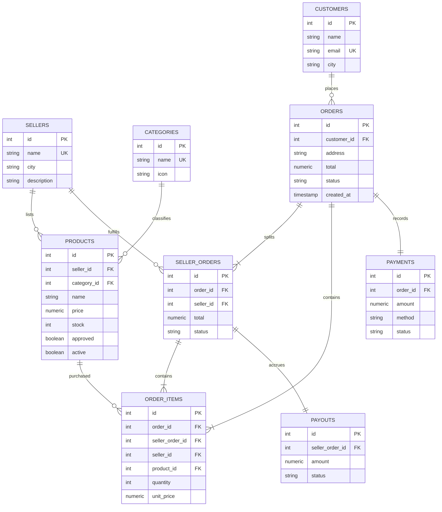

# Relational model

`order_items` resolves the many-to-many relationship between orders and products. The composite foreign key `(seller_order_id, order_id, seller_id)` prevents a line being attached to another order's seller shipment. Unique keys prevent duplicate seller shipments per order, duplicate products per order, and duplicate payment/payout records. The application creates the required item, payment, and payout rows in the same transaction; foreign keys alone do not enforce a minimum child count.

MongoDB collections are separate: `reviews` links to SQL products by numeric `productId`; `click_events` stores activity; `search_logs` stores flexible search evidence. There is no cross-database transaction or foreign-key enforcement. Orders deliberately stay entirely in PostgreSQL, so analytics failures cannot partially commit a checkout. Soft deletion retains historic product references. Anonymous reviews are not verified purchases.
